# Pomotrack

Pomodoro timer and task time tracker. Frontend only, no build step, no backend.

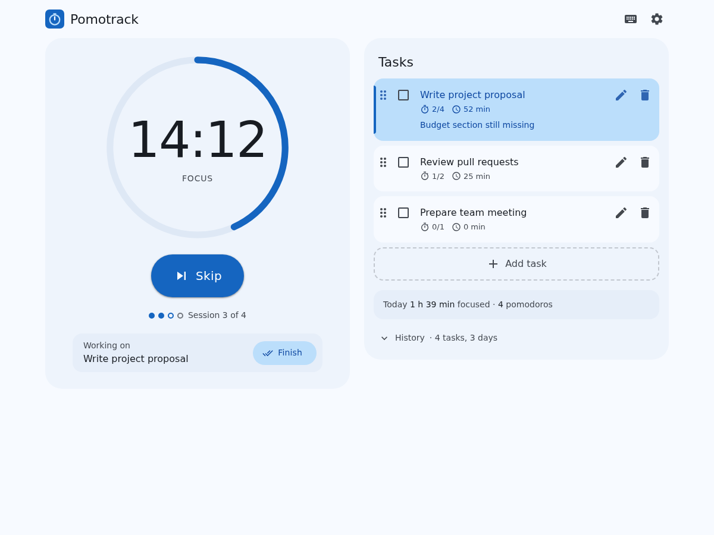

## Features

- **Pomodoro timer:** focus sessions of 25 minutes with a short break after each one, and a long break after every fourth. Each interval starts when you click Start, and you can skip it.
- **Adjust a single interval:** before you press Start, click the time and type a new one. Only this interval changes.
- **Task list:** write down what you want to work on, with notes and an estimate of pomodoros. Edit and delete tasks, and drag them into a new order.
- **Current task:** one open task is the current task. Focus time and finished sessions count for the current task and for the day.
- **Finish tasks:** mark a task as done at any time, also during a session. The timer keeps running and the next task takes over.
- **History:** finished tasks move into a history grouped by day. It shows the focus time and pomodoros of each day, and how many sessions each task took against its estimate.
- **Daily overview:** see today's focus time and pomodoros.
- **Reminders:** a sound and an optional desktop notification tell you when an interval ends. The app has to be open in a tab or window for this.
- **Several tabs:** all open tabs of the app show the same tasks and the same timer.
- **JSON export and import:** download your tasks and the totals of each day as a JSON file, and import such a file again, for example in another browser. An import replaces the tasks and totals.
- **Keyboard shortcuts:** control the app without a mouse. Press `?` in the app to see all shortcuts.
- **Accessible:** works with screen readers and keyboard only. Supports light and dark mode and reduced motion.
- **Private:** your data stays in your browser. There is no account and no server. The settings can delete all data.
- **Works offline:** when hosted online, the app can be installed like a regular app and keeps working without internet.

## Screenshots

| View                    | Light                                                  | Dark                                                 |
| ----------------------- | ------------------------------------------------------ | ---------------------------------------------------- |
| Focus session           |           | 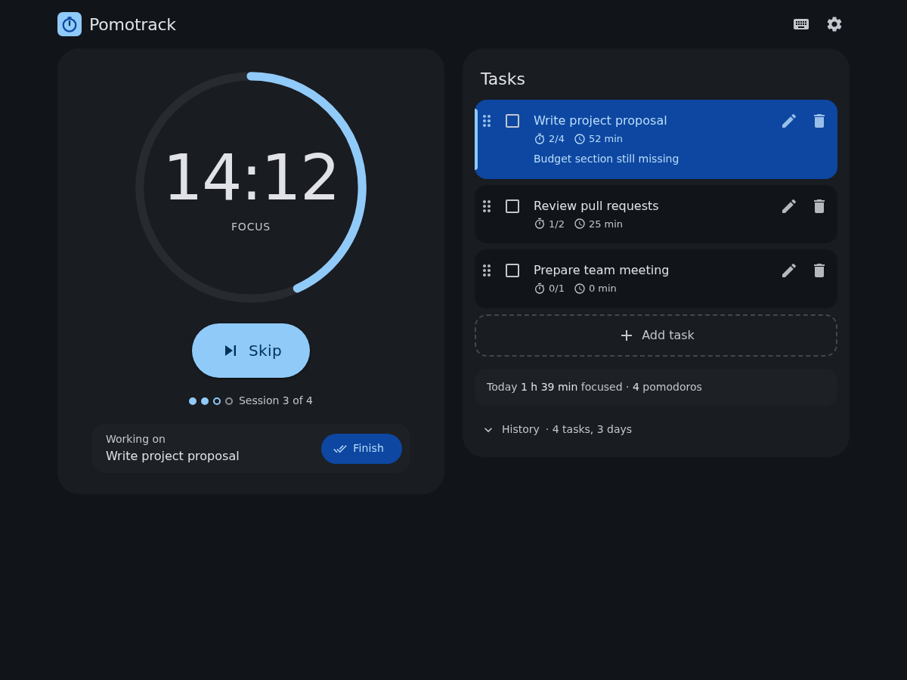          |
| Short break             | 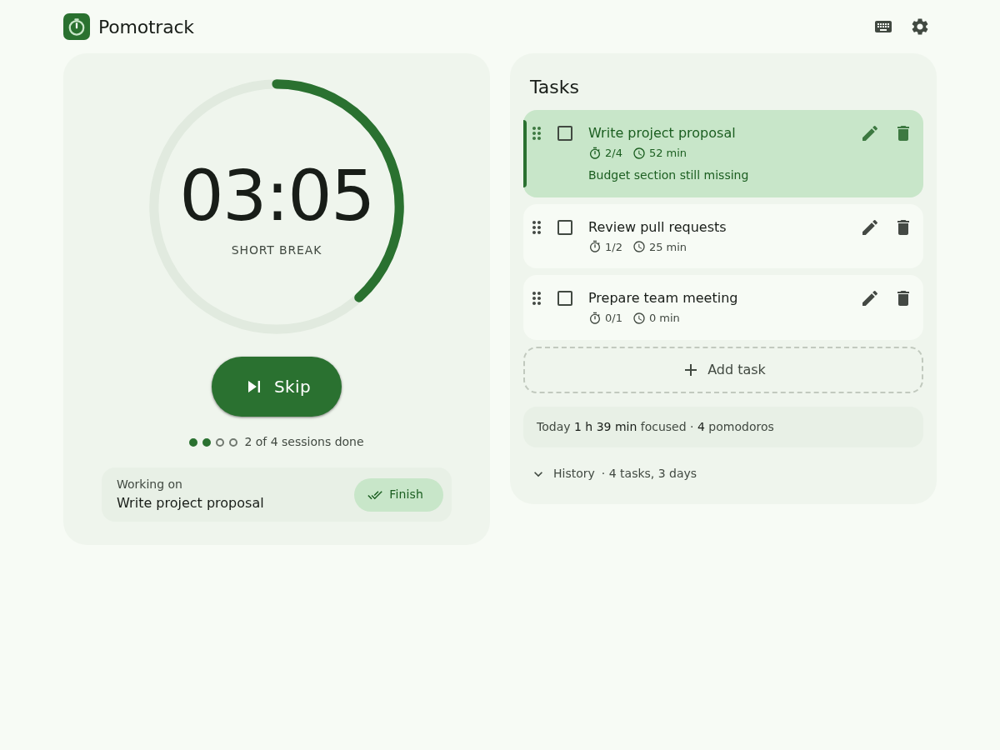      | 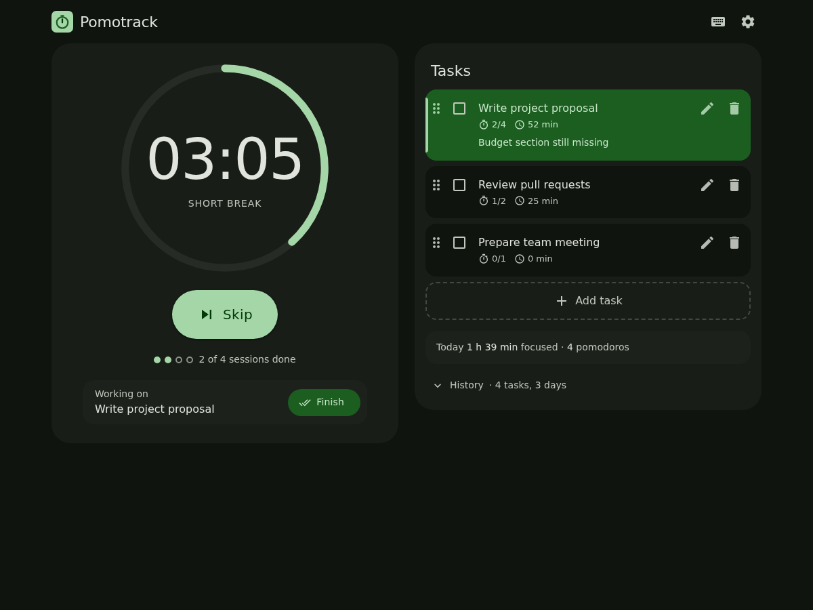      |
| Long break              | 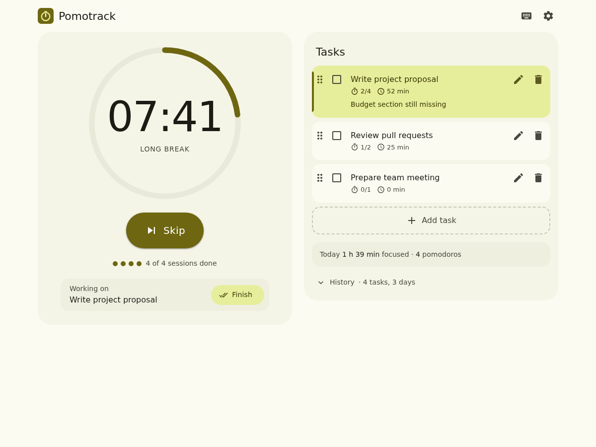        | 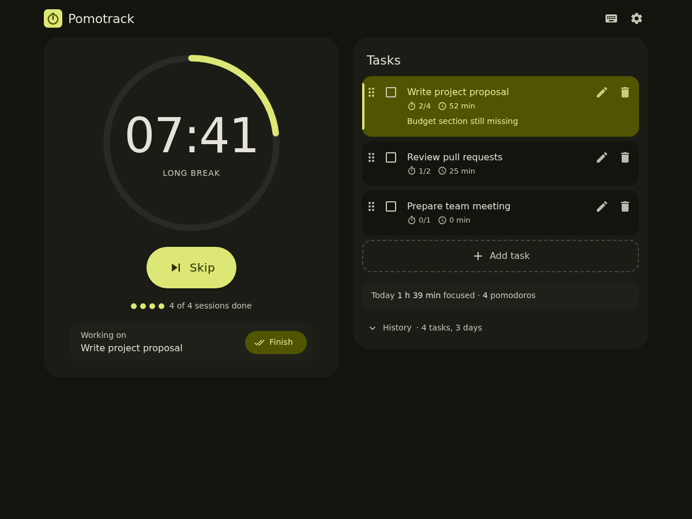        |
| History of earlier days | 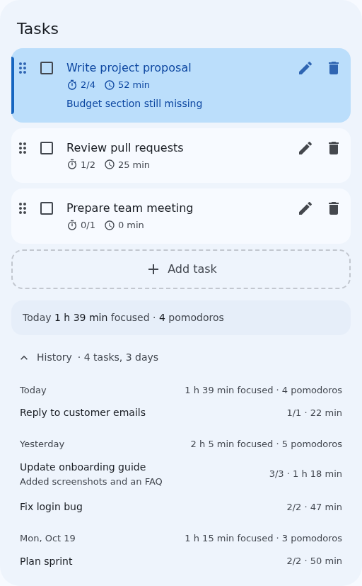              | 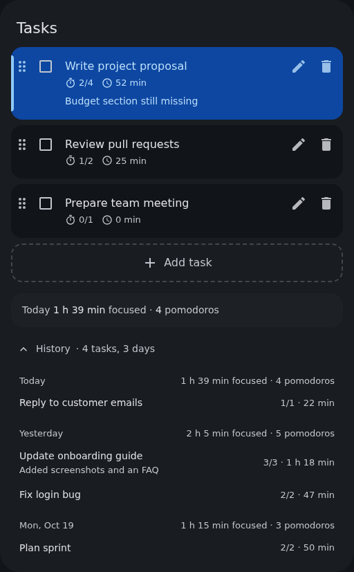              |
| Settings                | 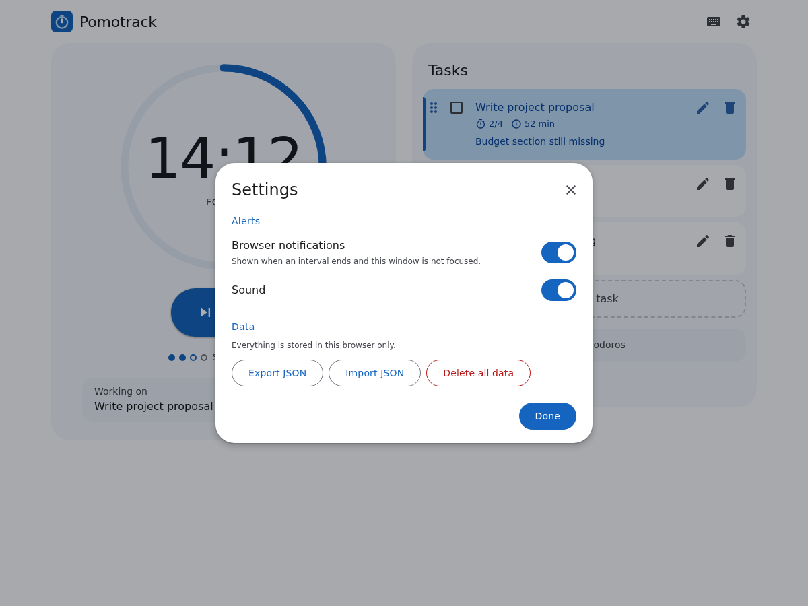            | 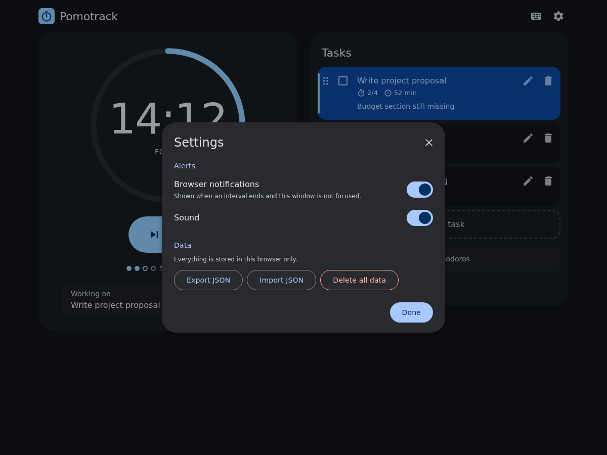            |
| Keyboard shortcuts      | 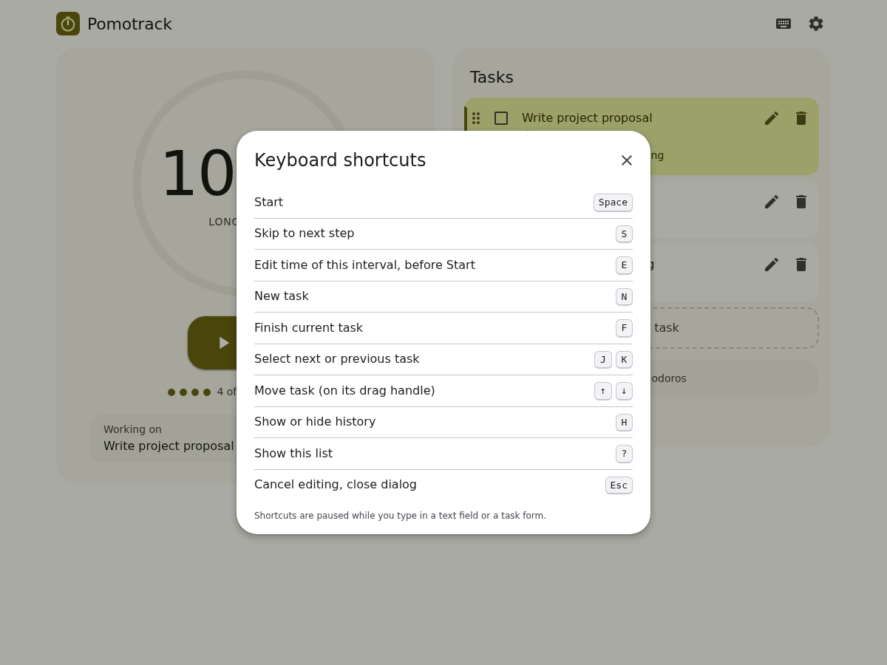 | 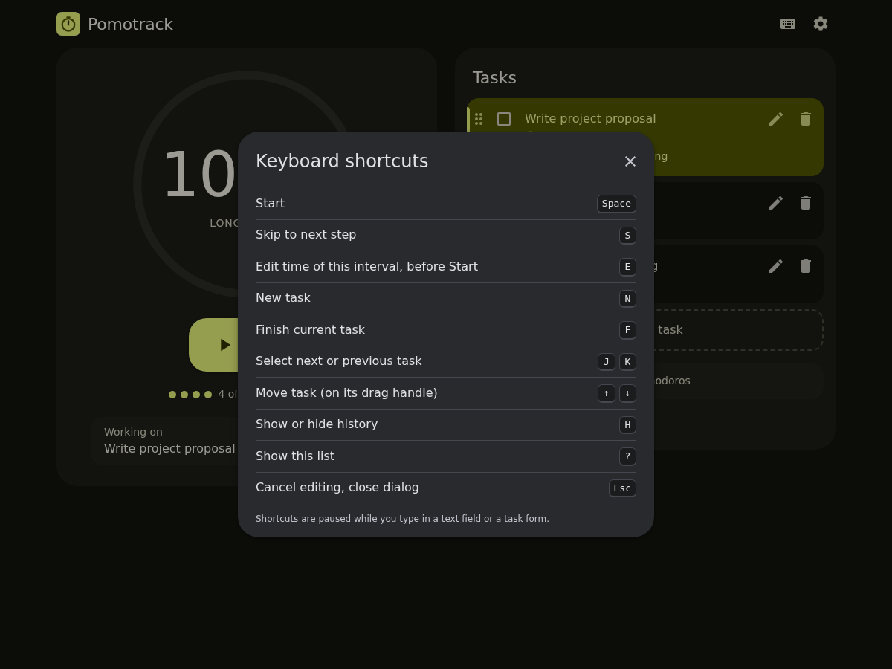 |
| On a phone              | 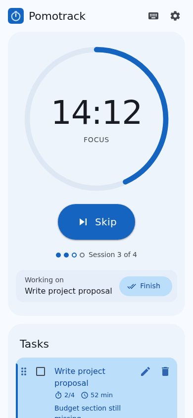    | 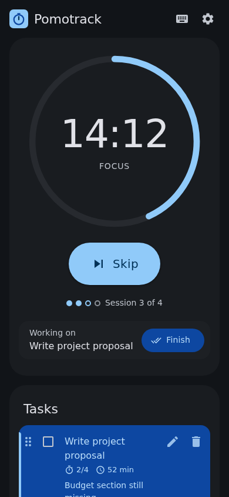    |

## Use

- **Single file:** `index.html` is self-contained. Open it in a browser to use the app.
- **Installable app with offline support:** host the folder over HTTPS. `manifest.webmanifest`, the icons and `sw.js` make it installable and let it work offline.
- **Built for GitHub Pages:** GitHub Pages serves the folder as it is, without a build step, from a sub-path like `https://<user>.github.io/pomotrack/`. The comments in `sw.js` explain how the service worker handles that.

## Tests

The end-to-end tests in `e2e/` use [Playwright](https://playwright.dev). They are the detailed description of how the app behaves, for example how a skipped session counts or what happens after the computer slept. Each spec file covers one area:

| File                    | Area                                                                                                |
| ----------------------- | --------------------------------------------------------------------------------------------------- |
| `timer.spec.ts`         | Pomodoro cycle, Start and Skip, the time of an interval, coming back later, sound and notifications |
| `tasks.spec.ts`         | Adding, editing, finishing, deleting and reordering tasks, the current task, time tracking          |
| `history.spec.ts`       | History and day boundaries                                                                          |
| `tabs.spec.ts`          | The app open in several tabs                                                                        |
| `dialogs.spec.ts`       | Settings, export and import, deleting all data, the list of shortcuts                               |
| `storage.spec.ts`       | Stored data from earlier versions and broken data                                                   |
| `keyboard-only.spec.ts` | The whole app with Tab, Enter, Space, Escape and the arrow keys, without a mouse or shortcuts       |
| `a11y.spec.ts`          | Accessibility checks with axe-core (WCAG 2.2 AA), screen reader messages, phone layout              |
| `pwa.spec.ts`           | Installation and offline use                                                                        |
| `screenshots.spec.ts`   | The reference screenshots in `docs/`                                                                |

The test server serves the app from a sub-path, like GitHub Pages does.
Tests find elements by role, accessible name or visible text, the way users and screen readers do, never by id or CSS class. They build their data through the app and check what it shows or exports. Larger sample data, like the sample day of the screenshots, comes in through Import JSON. Only `storage.spec.ts` writes the stored data directly, to check data of earlier versions and broken data.
Tests click buttons by default. Each feature's keyboard shortcuts have their own `keyboard shortcuts` block in its spec file.
A fake clock fast-forwards through sessions, and every test fails if the browser console shows a message.
The screenshots in `docs/` double as reference images, each view in light and dark mode. A test fails when a view no longer looks like its screenshot.

```sh
npm ci                            # install node dependencies required for running the tests
npx playwright install chromium   # install browser used by playwright
npm test                          # type check, then all tests
npm run screenshots               # update the screenshots in docs/ after an intended visual change
npm run serve                     # serve the app on http://127.0.0.1:4173/pomotrack/
```

## License

[MIT](LICENSE)
